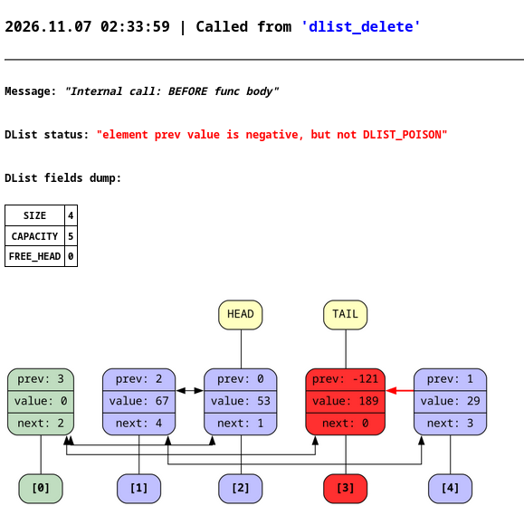
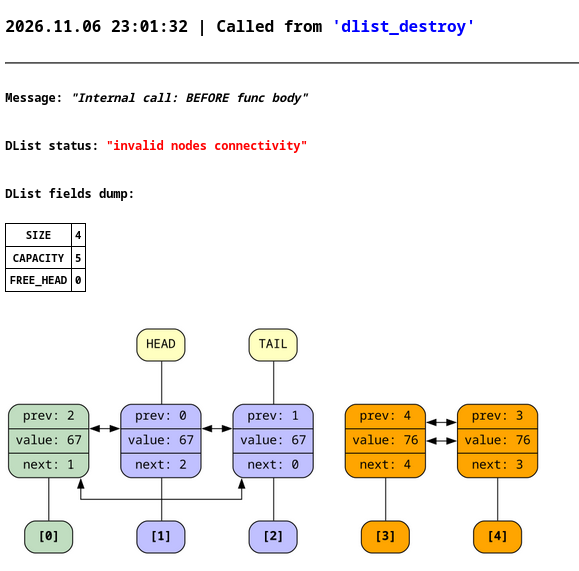
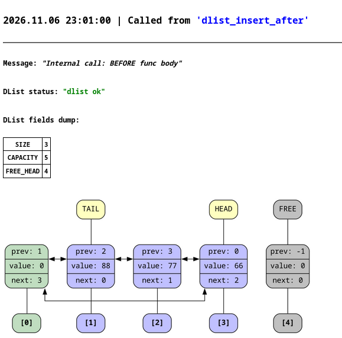

# dlist (двусвязный список)

## Описание
Данный проект реализует двусвязный список с системой графической отладки. Для списка генерируется визуальный дамп через `graphviz`, который затем логируется в `html` файл вместе с дополнительной информацией.


<details>
<summary><b>Ещё примеры дампов</b></summary>



</details>


Двусвязный список также зациклен в кольцо и содержит нулевой фиктивный элемент. Такая реализцация позволяет избежать дополнительных проверок и упрощает код.
Свободные элементы списка образуют односвязный список, что позволяет получать индекс свободного элемента за `O(1)`.

Состояние списка верифицируется на:
* достижимость всех вершин
* что все связи между элементами взаимные
* корректность значений `prev` и `next`
* корректность полей структуры

## Доступные методы списка

* `dlist_create` - конструктор списка
* `dlist_destroy`- деструктор списка
* `dlist_insert_after` - вставить элемента после индекса
* `dlist_insert_before` - вставить элесент до индекса
* `dlist_insert_tail` - вставить элемент после хвоста
* `dlist_insert_head` - вставить элемент до головы
* `dlist_delete` - удалить элемент по индексу
* `dlist_get` - получить элемент по индексу
* `dlist_change` - поменять значение элемента по индексу
* `dlist_head` - получить голову списка
* `dlist_tail` - получить хвост списка

* `dlist_verify` - тихий верификатор списка
* `dlist_error_str` - переводит числовый статус об ошибке в более подробное строковое сообщение

## Компиляция и запуск

Для компиляции можете воспользоваться скриптом `compile.sh`:
```bash
./compile.sh examples/example1.c
```
