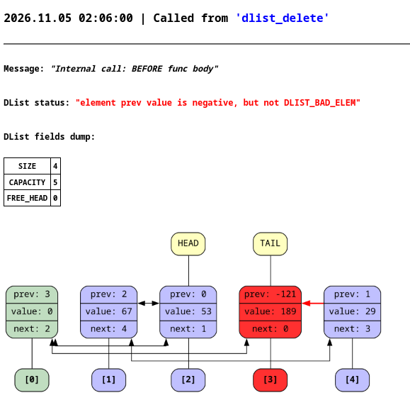

# dlist (двусвязный список)

## Описание
Данный проект реализует зацикленный в кольцо двусвязный список с фиктивным нулевым элементом. Такая реализация позволяет избежать дополнительных проверок в методах списка и упрощает код.

Для проекта реализована графическая отладка через `graphviz`. Список логируется в `html` файл вместе со своим визуальным представлением.



Состояние списка верифицируется на:
* достижимость всех вершин в списке
* что все связи между элементами взаимные
* корректность значений `prev` и `next`
* корректность полей структуры

## Компиляция и запуск

Для компиляции можете воспользоваться скриптом `compile.sh`:
```bash
./compile.sh examples/example1.c
```
