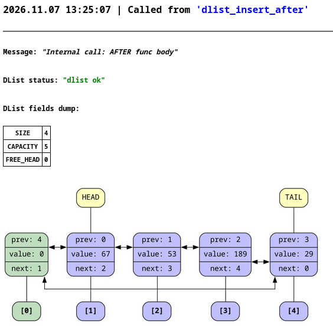
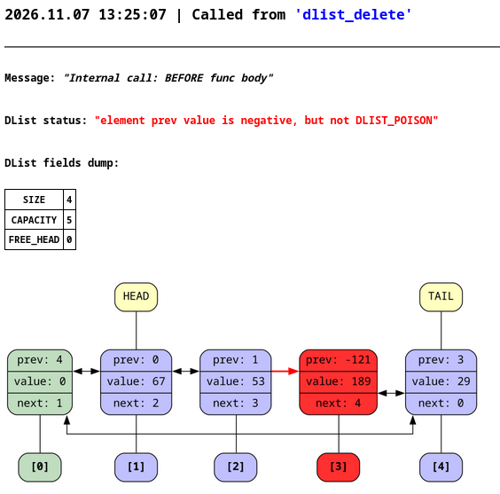
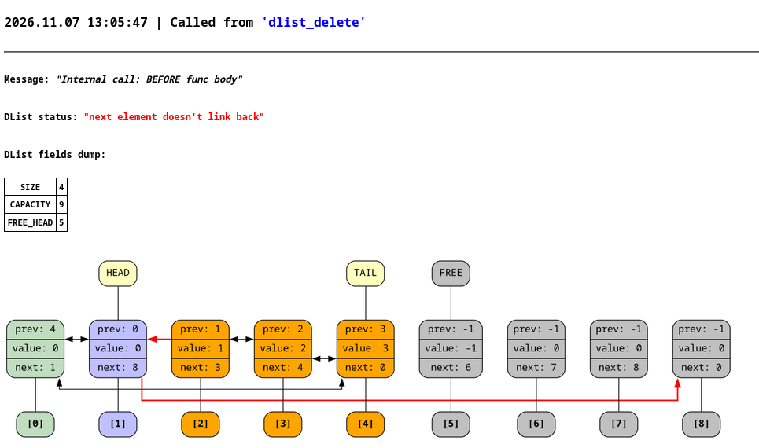

# dlist (двусвязный список)

## Описание
Данный проект реализует двусвязный список с системой графической отладки. Для списка генерируется визуальный дамп через `graphviz`, который затем логируется в `html` файл вместе с дополнительной информацией.



> **Картинка слева** - дамп списка, когда с ним всё хорошо
>
> **Картинка справа** - дамп списка, когда мы вручную испортили поле `prev` (поменяли значение на `-121`)

<details>
<summary><b>Ещё примеры дампов</b></summary>




> *Оранжевым помечены элементы, недостижимые из головы*
</details>

Состояние списка верифицируется на:
* достижимость всех вершин
* что все связи между элементами взаимные
* корректность значений `prev` и `next`
* корректность полей структуры

## Реализация
В отличие от классической реализации двусвязного списка, когда для каждого элемента отдельно происходит аллокация, здесь все элементы хранятся в одном блоке памяти, который был алоцирован единожды при вызове конструктора. Этот блок динамически увеличивается, если для новых элементов не хватает места.

Двусвязный список также зациклен в кольцо и содержит нулевой фиктивный элемент. Это позволяет упростить код, так как тогда не приходится отдельно прописывать сценарии для обработки крайних случаев - вставка в пустой список, вставка до головы, вставка после хвоста. В такой реализации получается так, что `prev` фиктивного элемента - это индекс хвоста, а `next` - индекс головы.

Помимо этого, своободные элементы списка образуют односвязный список, что позволяет получать индекс свободного элемента за `O(1)`, не выполняя поиск по всему массиву.

## Доступные методы списка

* `dlist_create` - конструктор списка
* `dlist_destroy`- деструктор списка
* `dlist_insert_after` - вставить элемента после индекса
* `dlist_insert_before` - вставить элесент до индекса
* `dlist_insert_tail` - вставить элемент после хвоста
* `dlist_insert_head` - вставить элемент до головы
* `dlist_delete` - удалить элемент по индексу
* `dlist_get` - получить значение элемента по индексу
* `dlist_get_next` - получить значение следующего элемента по индексу
* `dlist_get_prev` - получить значение предыдущего элемента по индексу
* `dlist_get_next_ind` - получить индекс следующего элемента
* `dlist_get_prev_ind` - получить индекс предыдущего элемента
* `dlist_change` - поменять значение элемента по индексу
* `dlist_head` - получить голову списка
* `dlist_tail` - получить хвост списка

* `dlist_verify` - тихий верификатор списка
* `dlist_error_str` - переводит числовый статус об ошибке в более подробное строковое сообщение

## Компиляция и запуск

Для компиляции можете воспользоваться скриптом `compile.sh`:
```bash
./compile.sh examples/example1.c
```
